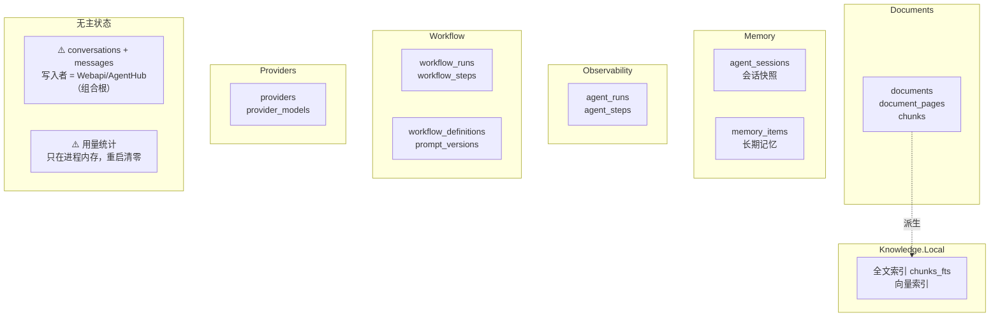
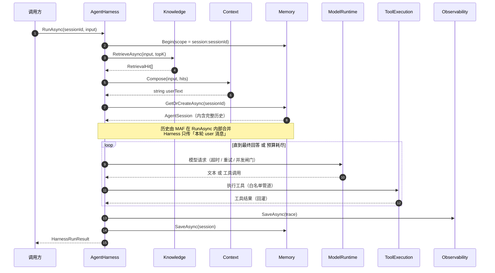

# 执行环与状态台账

> **怎么读**：VS Code 打开本文件 → `Ctrl+Shift+V`（预览）或 `Ctrl+K V`（右侧分屏实时预览）。
> 已装的 `vstirbu.vscode-mermaid-preview` 会把 ` ```mermaid ` 代码块渲染成图，无需额外安装。
>
> **这份文件干什么**：回答「某个能力该归哪个模块」。
> 方法不是看功能名像谁，而是看**这份状态在谁手里**——归属是状态所有权的下游结论。
>
> **怎么维护**：改了表结构 / 依赖方向 / 不变量，回来同步这里。它是活的，不是一次性报告。

---

## ① 状态所有权图

谁拥有哪些状态。**先看最后一个框。**



**`NOBODY` 框里那两条，就是你现在所有归属困惑的根源。** 它们不是「归谁」，是「**还没有主**」。

---

## ② 执行环泳道图（Agent Harness 路径）



### 箭头上的「交接了什么」= 边界候选

| 交接 | 从 → 到 | 边界的含义 |
| --- | --- | --- |
| `RetrievalHit[]` | Knowledge → Harness | 检索只出**结构化命中**，不出文本 |
| `string userText` | Context → Harness | Context 是**纯函数**：进文本出文本，**不碰历史、不碰库** |
| `AgentSession` | Memory → Harness | 历史的**持有者**是 Memory；装配者不是 |
| 工具结果 | ToolExecution → MAF | 工具结果的消费者是模型，不是 Context |

> 对话路径（`Webapi/AgentHub` → `Conversation.ChatService`）与这条不同：
> 它**不用 session**，历史由调用方从 `messages` 表读出来、整表传进 `BuildMessages`。
> 两条路并存 = `Conversation/README.md` §二 已经记着的那个问题。

---

## ③ 状态台账

| 表 / 状态 | 谁**生** | 谁**改** | 谁**读** | 活多久 | 不变量 | 主人 |
| --- | --- | --- | --- | --- | --- | --- |
| `conversations` / `messages` | `Webapi/AgentHub` | 同 | `AgentHub`、`ConversationsController` | 永久 | — | ❌ **无模块主人** |
| `agent_sessions` | `Memory.Persistence` | 同（MAF 序列化） | `AgentHarness` | `SessionTtlMinutes` | INV-1 | ✅ Memory |
| `memory_items` | `Memory.Persistence` | `remember` 工具 | `recall` 工具 | `expires_at` | INV-2、INV-3 | ✅ Memory |
| `agent_runs` / `agent_steps` | `Observability`（Harness 写入） | 追加 | 查询 API | 永久 | INV-9、INV-13 | ✅ Observability |
| `workflow_runs` / `workflow_steps` | `Workflow` | `Workflow` | `Workflow` | 永久 | 检查点可续 | ✅ Workflow |
| `prompt_versions` | `Workflow`（`IPromptStore`） | 追加不改 | `Workflow` | 永久 | 版本不可改写 | ✅ Workflow |
| `workflow_definitions` | `Webapi` 种子 + `WorkflowController` | 同 | `Workflow` | 永久 | — | ⚠️ **弱主**（配置类） |
| `providers` / `provider_models` | `Webapi/SettingsController` | 同 | `ChatClientFactory` | 永久 | API key 不入日志 | ⚠️ **弱主**（配置类） |
| `documents` / `document_pages` | `Documents` | `Documents` | `Documents`、`Knowledge.Local`、工具 | 永久 | — | ✅ Documents |
| `chunks` / `chunks_fts` / 向量 | `Documents` 产出 → `Knowledge.Local` 建索引 | `Knowledge.Local` | `Knowledge.Local` | 随文档 | 派生可重建 | ✅（派生） |
| **用量统计（内存）** | `ModelRuntime`（`ModelUsageMeter` 单例） | — | **无消费者** | **进程生命周期** | — | ❌ **无主 + 不可复盘** |

> 「⚠️ 弱主（配置类）」：写入者是 Webapi 的配置管理 API，模块本身只做读侧网关。这**可能**是合理的，但没写下来过，所以标出来。

---

## ④ 不变量清单

争议拿这个裁决，不靠讨论。最后一列是**谁在强制**。

| 编号 | 不变量 | 谁强制 |
| --- | --- | --- |
| INV-1 | 会话按 `sessionId` 隔离，禁止跨 id 复用 | 单测 + Memory 红线 |
| INV-2 | 记忆按 scope 隔离，跨 scope 召回为空 | 单测（负控：scope 过滤打开即红） |
| INV-3 | 作用域不由模型指定，`scope_id` 只来自编排层 | 单测 |
| INV-4 | `Context` 不产生 IO，不引 `Memory` / `Persistence` | **架构测试** + Context 红线 |
| INV-5 | `Context` 无命中必须原样返回 | 单测 |
| INV-6 | `Memory` 不引 `Persistence` | **架构测试** |
| INV-7 | 白名单外工具「模型看不到、也调不动」 | 单测 |
| INV-8 | 降级只允许「无工具重试一次」，不丢用户输入 | 单测 |
| INV-9 | 预算耗尽必须**收口**而不是报错 | 单测 + Harness |
| INV-10 | 依赖单向、无环 | **架构测试** |
| INV-11 | `Domain` 不引基础设施 | **架构测试** |
| INV-12 | 数据库变更只走 FluentMigrator，不改已发布迁移 | Persistence 红线 |
| INV-13 | 取消 ≠ 失败，两者归类码必须分开 | 单测 |
| INV-14 | 组合根是唯一允许依赖所有模块的地方 | **架构测试**（负控） |

---

## ⑤ 这份台账推出来的决定

不需要讨论，查表即有答案：

### 1. `Context` 名下的「历史裁剪 / 压缩」——**归属错了**

- 台账说：历史的**持有者**是 Memory，「谁**改**」那一列是**装配点**。
- `Context` 不在「谁改」那一列——它的交接是 `string → string`（见 ② 表），**结构上碰不到历史**。

**结论**：裁剪策略可以留 `Context`（纯逻辑允许），**裁剪的执行必须落在装配点**。
现在三份 README（`Context` §二、`Memory` 第 7/115 行、`Conversation` §二）都写着「裁剪归 Context」，要一起改。

### 2. 「拿不到用量」——**不是 `Context` 的问题**

- 用量在 `ModelRuntime`，且是**进程内、不落库**（台账倒数第二行）。
- `Context` 拿不到它，是因为**没有只读计量契约**，不是因为它管得太多。
- 这是 `ModelRuntime` 的契约缺口 + 一个无主状态。

### 3. 必须先定的一件事：`conversations` / `messages` 给谁

它是本文件里唯一一个**红色无主状态**，而且**组合根在写业务状态**。
不先给它找主，「对话历史怎么裁剪」「两个会话机制并存」这几个问题都定不干净。

---

## 附：本文件里的信息从哪来

| 来源 | 用途 |
| --- | --- |
| `src/AgentWorkbench.Persistence/Migrations/` | 16 张表的真实清单 |
| 各模块 `README.md` 的「红线」 | 不变量清单 |
| `tests/AgentWorkbench.ArchitectureTests/LayeringTests.cs` | 哪些不变量被机器强制 |
| 源码 grep（仓储接口的消费者） | 「谁改」那一列 |

> 未核实到实处的项已在表中标「?」或「⚠️」，不要当成结论引用。
